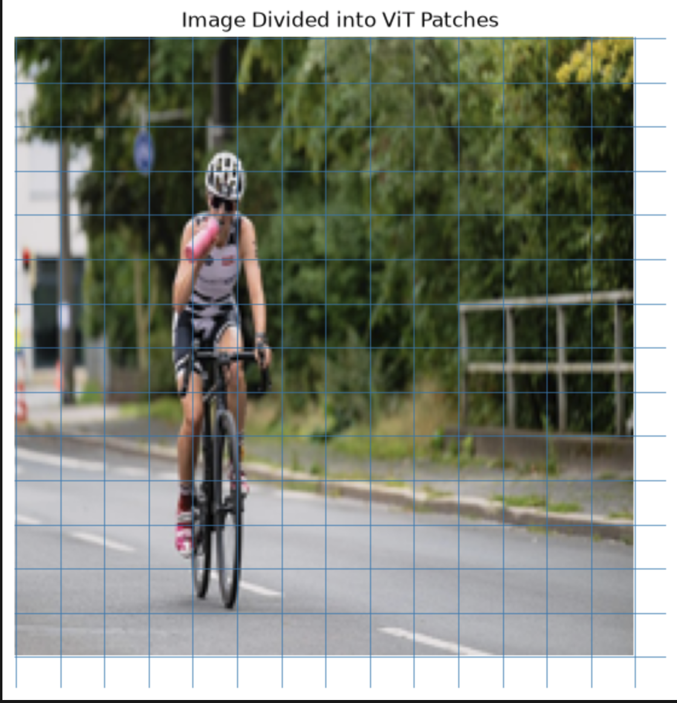
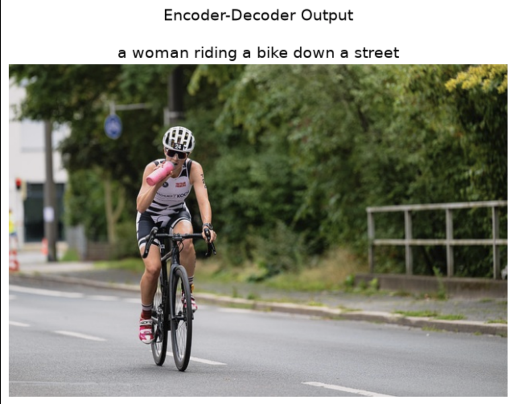

# Encoder–Decoder Image Captioning with ViT and BLIP

An image captioning project demonstrating visual feature extraction with Vision Transformer (ViT) and text generation with the pretrained BLIP encoder–decoder model.

## Overview

The notebook explores how an image is represented as visual patches and embeddings, then uses BLIP to generate a natural-language caption for the input image.

## Architecture

1. **ViT feature extraction:** Divides the image into patches and produces contextual visual representations.
2. **BLIP vision encoder:** Encodes the input image into visual features.
3. **BLIP text decoder:** Generates a text caption conditioned on the encoded image.

The notebook loads pretrained checkpoints. It does not train or fine-tune either model.

## Highlights

- Loads and displays an input image.
- Demonstrates ViT patch embeddings and the `[CLS]` image embedding.
- Loads the pretrained BLIP image-captioning model.
- Generates a caption using autoregressive decoding.
- Displays the generated caption alongside the input image.

## Technology Stack

Python, PyTorch, Torchvision, Hugging Face Transformers, Pillow, Matplotlib

## Repository Structure

```text
vit-blip-encoder-decoder-image-captioning/
├── README.md
├── cat.jpeg
├── requirements.txt
├── .gitignore
├── image/
│   ├── cycling.jpg
│   ├── image_vit_patches.png
│   └── captioned_image.png
└── notebooks/
    └── implement-encoder-decoder.ipynb
```

## Setup

Create and activate a virtual environment, then install the dependencies.

```bash
python -m venv .venv

# Windows PowerShell
.venv\Scripts\Activate.ps1

# macOS / Linux
source .venv/bin/activate

pip install -r requirements.txt
```

For GPU acceleration, install the PyTorch build that matches your CUDA setup using the official PyTorch installation instructions.

## Run the Notebook

Open `notebooks/implement-encoder-decoder.ipynb` in Jupyter Notebook or VS Code with the Jupyter extension, select your Python environment, and run the cells in order.

The notebook uses `cat.jpeg` from the repository root. It downloads the pretrained model checkpoints from Hugging Face the first time they are needed. The BLIP checkpoint is large, so allow time and disk space for the download.

## Example Output

The following images illustrate the input image, ViT patch extraction, and the final caption generated by the BLIP model.

### 1. Input Image

The original cycling image provided to the image captioning pipeline. It serves as the input for visual feature extraction and caption generation.


### 2. ViT Image Patches

This visualization demonstrates how Vision Transformer divides an image into smaller patches. These patches are converted into embeddings that the model processes to understand visual information.



### 3. Generated Image Caption

The final output displays the input image alongside the caption generated by the pretrained BLIP model.

For the included sample image in repo, the notebook's recorded caption was:

> a woman riding a bike down a street


The generated caption may vary with library versions and generation settings.

## Limitations and Future Improvements

- The implementation uses pretrained models and does not include model training or fine-tuning.
- Caption quality depends on the pretrained checkpoint and the input image.
- The notebook demonstrates ViT embeddings separately; BLIP uses its own vision encoder and text decoder for caption generation.
- Future work could include batch image captioning, a simple web interface, and evaluation on a captioning benchmark.
